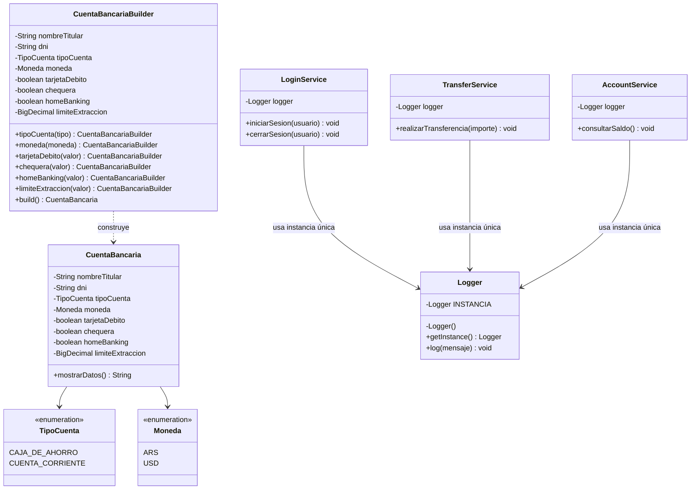

# TP 6 – Builder y Singleton Bancario

Este trabajo implementa dos patrones de diseño en Java: **Builder**, para armar cuentas bancarias con opciones sin constructores largos, y **Singleton**, para compartir una única instancia de logger entre servicios.

## Estructura

- `CuentaBancaria.java`: cuenta inmutable con titular, DNI, tipo, moneda, servicios y límite.
- `CuentaBancariaBuilder.java`: configura la cuenta mediante métodos encadenables y la crea con `build()`.
- `TipoCuenta.java` y `Moneda.java`: opciones permitidas para tipo de cuenta y moneda.
- `Logger.java`: registrador Singleton con `getInstance()` y `log(String mensaje)`.
- `LoginService.java`, `TransferService.java` y `AccountService.java`: servicios que reciben y utilizan el logger compartido.
- `Main.java`: demuestra los ejemplos básico y premium, la identidad del Singleton y los eventos de log.

## Diagrama UML



## Patrón Builder

El constructor de `CuentaBancaria` no es público: las cuentas se crean mediante `CuentaBancariaBuilder`. Los datos obligatorios (titular y DNI) se indican al crear el builder; las demás opciones se configuran con métodos encadenables. `build()` valida y devuelve una cuenta inmutable.

La cuenta básica del ejemplo usa Caja de Ahorro en ARS, Home Banking y tarjeta de débito, sin chequera y con límite de extracción de 0 ARS (la consigna no define otro límite). La cuenta premium usa Cuenta Corriente en USD, Home Banking, tarjeta, chequera y límite de 2.000.000.

## Patrón Singleton

`Logger` tiene constructor privado y una instancia estática única. `LoginService`, `TransferService` y `AccountService` reciben `Logger.getInstance()`. `Main` compara las referencias con `==` y muestra que son la misma instancia.

## Compilar y ejecutar

Con JDK instalado, desde esta carpeta:

```bash
javac -d out *.java
java -cp out Main
```

## Salida esperada (resumen)

```text
Todos los servicios usan la misma instancia: true
[INFO] Usuario fede inició sesión
[INFO] Transferencia realizada por $50000
[INFO] Consulta de saldo realizada
[INFO] Usuario fede cerró sesión
```
