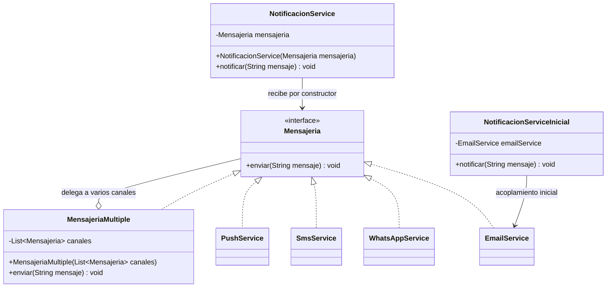

# TP 8 – DIP e Inyección de Dependencias

## Objetivo

El programa simula un sistema de notificaciones bancarias y muestra la diferencia entre depender directamente de un canal y depender de una abstracción. Está implementado en Java sin frameworks.

## Estructura de clases

- `Mensajeria`: interfaz con el contrato `enviar(String mensaje)`.
- `EmailService`, `WhatsAppService`, `SmsService` y `PushService`: implementaciones concretas intercambiables.
- `NotificacionServiceInicial`: ejemplo didáctico de la Parte 1, acoplado a `EmailService`.
- `NotificacionService`: recibe `Mensajeria` por constructor y no conoce los canales concretos.
- `MensajeriaMultiple`: implementación compuesta de `Mensajeria`; reenvía un mismo mensaje a varios canales.
- `Main`: demuestra el diseño inicial, los cuatro canales, el canal push agregado y el envío multicanal opcional.

## Diagrama UML de la solución final



## Parte 1 – Diseño inicial

`NotificacionServiceInicial` depende directamente de `EmailService`. Si se quiere enviar por WhatsApp, hay que modificar este servicio (o crear otro), porque el canal concreto está fijado en su dependencia. Si se agregan muchos medios, la lógica principal empieza a acumular dependencias y cambios por cada canal; esto aumenta el acoplamiento y hace más difícil extender y probar el sistema.

La clase está incluida para comparar diseños. La solución final utiliza `NotificacionService`, que depende de `Mensajeria`.

## Parte 2 y 3 – DIP e inyección de dependencias

`NotificacionService` recibe una instancia de `Mensajeria` en el constructor y solamente invoca `enviar`. Para agregar un canal, alcanza con crear otra clase que implemente la interfaz e inyectarla desde el punto de composición (`Main`). Por eso se agregó `PushService` sin editar `NotificacionService`.

El servicio no contiene `if` ni `switch` para detectar el tipo de canal y tampoco instancia implementaciones concretas.

## Parte 4 – Preguntas conceptuales

### ¿Qué establece el principio DIP de SOLID?

El Principio de Inversión de Dependencias indica que los módulos de alto nivel (la lógica principal) no deberían depender de módulos de bajo nivel (detalles concretos). Ambos deben depender de abstracciones. Además, las abstracciones no deben depender de los detalles; los detalles deben depender de las abstracciones.

### ¿Qué diferencia existe entre depender de una clase concreta y depender de una interfaz?

Al depender de una clase concreta, el código queda ligado a esa implementación y cambiarla suele exigir modificar al consumidor. Al depender de una interfaz, el consumidor se apoya en un contrato compartido y puede trabajar con cualquier implementación que lo cumpla.

### ¿Qué es la inyección de dependencias?

Es una técnica por la cual un objeto recibe desde afuera los colaboradores que necesita, en lugar de crearlos por sí mismo. En este TP, `NotificacionService` recibe un `Mensajeria`.

### ¿Qué ventajas tiene utilizar inyección por constructor?

Hace explícitas las dependencias, permite construir el objeto en un estado válido desde el inicio y facilita reemplazar una implementación por otra o por un doble de prueba. También evita que el servicio cree o seleccione internamente sus dependencias.

### ¿Por qué el diseño desarrollado facilita agregar nuevas funcionalidades?

Cada canal implementa el mismo contrato. Se puede añadir, por ejemplo, `PushService` sin modificar la lógica de `NotificacionService`; solo se crea la implementación y se la inyecta desde el lugar que configura la aplicación.

### ¿Qué relación existe entre DIP y el principio Open/Closed (OCP)?

DIP permite que el código de alto nivel dependa de abstracciones estables. Así, el comportamiento puede extenderse agregando implementaciones nuevas sin modificar el servicio principal, lo que ayuda a cumplir OCP: abierto a la extensión y cerrado a la modificación.

## Desafío opcional – Envío simultáneo por varios canales

`MensajeriaMultiple` implementa la misma interfaz que los canales individuales y contiene una lista de `Mensajeria`. El servicio de notificación no necesita cambios: recibe el compuesto y este delega el envío a cada canal. Este diseño se conoce como patrón Composite.

## Compilar y ejecutar

Con JDK instalado, desde esta carpeta:

```bash
javac -d out *.java
java -cp out Main
```

La salida de consola es la evidencia reproducible para capturar: muestra el envío por Email, WhatsApp, SMS y Push, además del ejemplo multicanal.
